

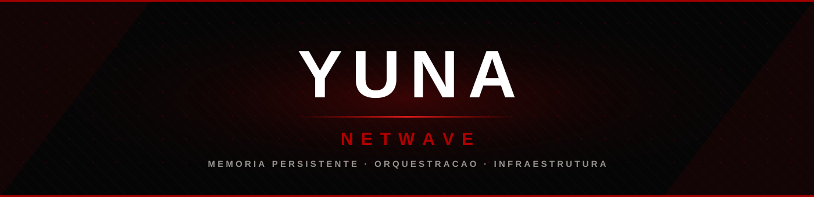

   

## Quem é a Yuna

Roda no **CachyOS** do Hiro, com identidade própria e memória persistente.
Consulta, aprende e guarda o que importa — projetos, decisões, preferências —
entre sessões. Orquestra ferramentas de segurança, ajuda no dia a dia
e conversa como uma parceira de verdade.

   

Ela não substitui o código — ela dá vida ao sistema.

## Projetos

<table>
<tr>
<td width="50%" valign="top">

<a href="https://github.com/hiro0010/axiom">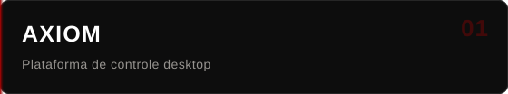</a>

 

<b>AXIOM</b> — Núcleo com módulos instaláveis. O usuário escolhe no wizard o que instalar; a permissão vem da conta, não do instalador.

Electron · React · TypeScript

  
<a href="https://github.com/hiro0010/netwave">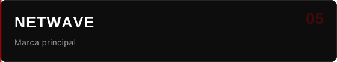</a>

 

<b>NETWAVE</b> — A raiz que dá nome, nomenclatura e identidade a todos os projetos. Infraestrutura e software, com gaming como uma das linhas.

Identidade · Nomenclatura · Visão

  
<a href="https://github.com/hiro0010/netwave-site">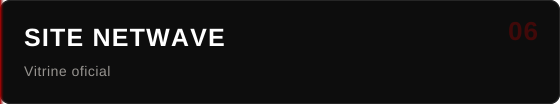</a>

 

<b>SITE NETWAVE</b> — Site público com store, status do servidor e área de conta. Autenticação real pelo Netwave ID.

netwave.cloud · nginx · Docker

  

 

<b>VITALIS</b> — O sistema imunológico da infraestrutura: mapeia dependências, detecta impacto quando algo cai e aciona contenção.

Detecção · Fallback · Contenção

  
<a href="https://github.com/hiro0010/netwaveos">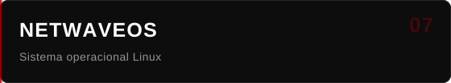</a>

 

<b>NETWAVEOS</b> — Distribuição sobre a base CachyOS com Hyprland, dashboard Quickshell, instalador Calamares e a Yuna embarcada em read-only.

archiso · Hyprland · Quickshell

  

</td>
<td width="50%" valign="top">

<a href="https://github.com/hiro0010/axionengine">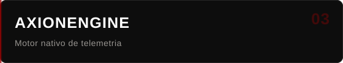</a>

 

<b>AXIONENGINE</b> — Addon C++20 user-mode que agrega 11 coletores de hardware num snapshot e expõe ao Axiom por N-API.

C++20 · CMake · N-API

  
<a href="https://github.com/hiro0010/mochi-ac">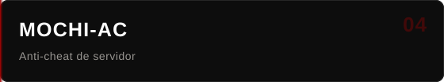</a>

 

<b>MOCHI-AC</b> — Reconstrói o movimento esperado e compara com os pacotes recebidos. Roda em alert-only, sem punição automática.

Java · Paper · PacketEvents

  
<a href="https://github.com/hiro0010/nyx-client">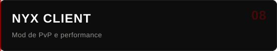</a>

 

<b>NYX CLIENT</b> — 38 módulos com ClickGUI, HUD custom e humanização de input para combate competitivo.

Java 21 · Fabric 1.21.1

  
<a href="https://github.com/hiro0010/axiom-bot">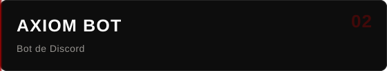</a>

 

<b>AXIOM BOT</b> — 64 comandos da comunidade com RBAC por cargo, cooldowns e modlogs por tipo de ação.

Node · TypeScript · discord.js

  

</td>
</tr>
</table>

## Capturas

<table>
<tr>
<td width="50%" valign="top"><a href="https://github.com/hiro0010/axiom">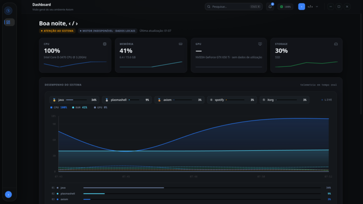</a>
 Painel de controle desktop
</td>
<td width="50%" valign="top"><a href="https://github.com/hiro0010/netwave-site">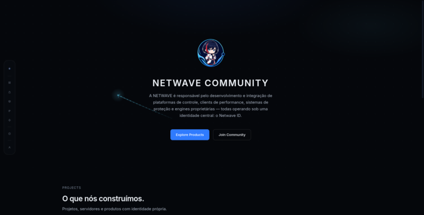</a>
 netwave.cloud
</td>
</tr>
<tr>
<td width="50%" valign="top"><a href="https://github.com/hiro0010/vitalis">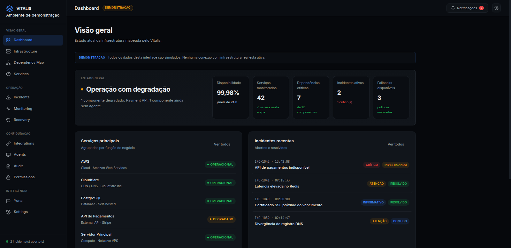</a>
 Mapa de dependências
</td>
<td width="50%" valign="top"><a href="https://github.com/hiro0010/nyx-client">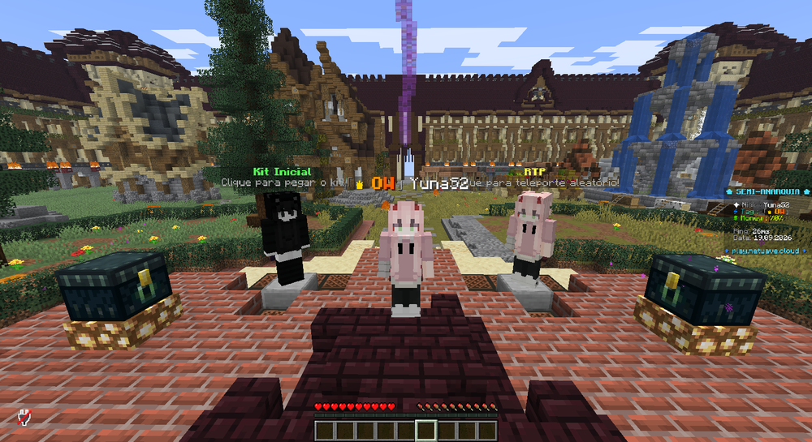</a>
 Servidor Minecraft
</td>
</tr>
</table>

## O que cada projeto faz

<table>
<tr>
<td width="50%" valign="top">

<b><a href="https://github.com/hiro0010/axiom">AXIOM</a></b> — Núcleo com módulos instaláveis. O usuário escolhe no wizard o que instalar; a permissão vem da conta, não do instalador.

<b><a href="https://github.com/hiro0010/netwave">NETWAVE</a></b> — A raiz que dá nome, nomenclatura e identidade a todos os projetos. Infraestrutura e software, com gaming como uma das linhas.

<b><a href="https://github.com/hiro0010/netwave-site">SITE NETWAVE</a></b> — Site público com store, status do servidor e área de conta. Autenticação real pelo Netwave ID.

<b><a href="https://github.com/hiro0010/vitalis">VITALIS</a></b> — O sistema imunológico da infraestrutura: mapeia dependências, detecta impacto quando algo cai e aciona contenção.

<b><a href="https://github.com/hiro0010/netwaveos">NETWAVEOS</a></b> — Distribuição sobre a base CachyOS com Hyprland, dashboard Quickshell, instalador Calamares e a Yuna embarcada em read-only.

</td>
<td width="50%" valign="top">

<b><a href="https://github.com/hiro0010/axionengine">AXIONENGINE</a></b> — Addon C++20 user-mode que agrega 11 coletores de hardware num snapshot e expõe ao Axiom por N-API.

<b><a href="https://github.com/hiro0010/mochi-ac">MOCHI-AC</a></b> — Reconstrói o movimento esperado e compara com os pacotes recebidos. Roda em alert-only, sem punição automática.

<b><a href="https://github.com/hiro0010/nyx-client">NYX CLIENT</a></b> — 38 módulos com ClickGUI, HUD custom e humanização de input para combate competitivo.

<b><a href="https://github.com/hiro0010/axiom-bot">AXIOM BOT</a></b> — 64 comandos da comunidade com RBAC por cargo, cooldowns e modlogs por tipo de ação.

</td>
</tr>
</table>

## Hiro · Owner

<b>Infrastructure · Software · Security</b>

 

Criador da <a href="https://github.com/hiro0010/netwave">Netwave</a> e da Yuna

## Stack

<table>
<tr>
<td width="22%" valign="top">

<b>Linguagens</b>
 o que escrevo
 
<b>Frameworks e runtime</b>
 o que executa
 
<b>Infraestrutura</b>
 o que sustenta
 
<b>Minecraft</b>
 servidor e cliente
 
<b>Desktop e SO</b>
 Axiom, NetwaveOS e nativo
 
<b>Ferramentas</b>
 no dia a dia

</td>
<td valign="top">

           
 
       
 
        
 
     
 
               
 
   

</td>
</tr>
</table>

## Em números

<table>
<tr>
<td valign="center">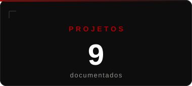</td>
<td valign="center">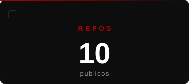</td>
<td valign="center">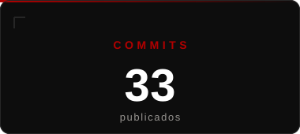</td>
</tr>
<tr>
<td valign="center">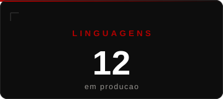</td>
<td valign="center">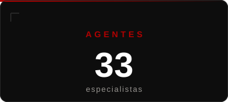</td>
<td valign="center">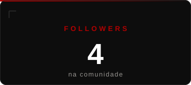</td>
</tr>
</table>

## Repositórios

        

---

© Hiro — Owner · Netwave

